<div align="center">


<br>

<!-- UPDATE THESE TWO LINKS -->
<a href="https://karwann-frontend.vercel.app/"></a>
&nbsp;&nbsp;
<a href="https://drive.google.com/file/d/16wBSfLdvNsXsoPN1FEJ6VLbRNtVhozs7/view"></a>
&nbsp;&nbsp;
<a href="docs/KARWAN_2_HANDOFF.md"></a>

<br><br>


**Karwan** (Urdu for *caravan*) puts help requests, depot stock and truck capacity in one place, ranks who needs help first with a score anyone can read, recommends how to share limited supplies, and tracks every delivery on a map. **Karwan 2.0** adds AI that understands Urdu and English reports (text or voice), without ever letting AI make the decision.

<sub>Denning Institute of Technology and Entrepreneurship, Hyderabad &nbsp;·&nbsp; Organised by TECHGEN &nbsp;·&nbsp; DITE Hackathon 2026-27</sub>

</div>

<br>

## Jump to

| # | Required by the guidelines | |
|:-:|---|---|
| 1 | Project name and team name with member names | [Go](#1-project-and-team) |
| 2 | Theme chosen and the problem we solve | [Go](#2-theme-and-problem) |
| 3 | How AI is used: model, input, output | [Go](#3-how-ai-is-used) |
| 4 | Tech stack | [Go](#4-tech-stack) |
| 5 | Steps to run the project locally | [Go](#5-run-it-locally) |
| 6 | Live deployment link | [Go](#6-live-deployment) |
| 7 | Demo video link | [Go](#7-demo-video) |
| 8 | Datasets, pre-trained models and resources, with credits | [Go](#8-datasets-models-and-credits) |

Also: [Screenshots](#screenshots) · [Features](#features) · [PRD](#product-requirements-prd) · [TRD](#technical-requirements-trd) · [User flows](#user-flows) · [Testing](#testing) · [Honest limits](#honest-limits)


## 1. Project and team

**Project name:** **Karwan** — Disaster Relief Resource Optimizer ("Right help. Right place. Right now.")

**Team name:** **Triple Bytes**

| Member | GitHub |
|---|---|
| Toufeeq Shaikh | [@toufeeqahmed916](https://github.com/toufeeqahmed916) |
| Ayan Ali Shaikh | [@ayanalishaikh31-crypto](https://github.com/ayanalishaikh31-crypto) |
| Ammar Talpur | [@ammartalpur](https://github.com/ammartalpur) |

**Institute:** Denning Institute of Technology and Entrepreneurship, Hyderabad · **Organiser:** TECHGEN · **Event:** DITE Hackathon 2026-27

## 2. Theme and problem

**Theme:** Category 4, **Climate & Disaster Resilience**. Problem statement **CL-03: Disaster Relief Resource Optimizer**.

**The problem.** In a flood, relief is often misplaced rather than only short: requests arrive as calls and messages, depot stock lives in notebooks, and trucks have limits, so supplies go to whoever called first or sits closest while the worst-hit, hardest-to-reach villages wait longest. Karwan matches requests with stock and trucks, ranks need with a transparent score, recommends a fair, explainable allocation, and tracks delivery to the doorstep. Karwan 2.0 also lets people report in **Urdu or English by text or voice**, which is how reports really arrive.

> **CL-03 brief:** *Build a coordination platform that matches requests for relief with available resources and recommends how limited supplies should be allocated across affected locations.*

## 3. How AI is used

<div align="center">
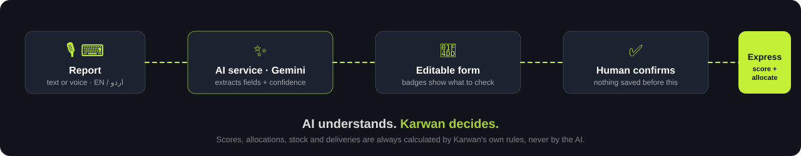
</div>

**The rule: AI understands and explains. Karwan's own code decides.** AI never calculates a score, allocates supplies, approves a plan or changes stock.

| | |
|---|---|
| **Model / API** | Google **Gemini** through the Gemini API (`google-genai` SDK). Default model alias `gemini-flash-lite-latest`, set by `GEMINI_MODEL`. |
| **Where it runs** | A separate **FastAPI microservice** (`ai-service/`). The browser never calls Gemini, and keys exist only on that service. |
| **Output format** | Gemini structured JSON, validated with Pydantic, one repair retry, then a friendly error. |

| Feature | Takes as input | Returns |
|---|---|---|
| **Report intake** `POST /intake` | One report: **text** (up to 5,000 chars) **or** **voice** (webm/ogg/wav/mp4, up to about 30 s), plus the UI language (`en` / `ur`) | Editable fields: `area`, `people` (+ `peopleIsEstimate`), `urgency`, `vulnerable[]`, `supplies[{item, qty}]`, `access`, `detectedLanguage`, an **English translation**, and a **0 to 1 confidence per field**. Unknown facts come back `null` or empty, never invented. |
| **Transcription** `POST /transcribe` | A short audio clip, optional target language | `{ text, detectedLanguage }` (used for voice questions) |
| **Coordinator assistant** `POST /chat` | A question + language. The service first reads **live data from Express** (read-only) | `{ inScope, answer, sources[] }` with exact stored quantities and reasons. Anything off-topic gets a fixed refusal. |
| **Website help bot** `POST /site-chat` | A question + language. Uses a built-in guide only, **no live data** | `{ inScope, answer }`, only about using the website |

**Guardrails.** Human confirmation before anything is saved. Confidence badges use text and icons, not colour alone. Express data is authoritative and read-only for AI. If Express is down the assistant says so instead of guessing (`KARWAN_API_UNAVAILABLE`). Timeouts, quota fail-over between two keys, and a manual form that always works. Only simulated data is ever sent to Gemini. Full contract: [`backend/AI_INTEGRATION_CONTRACT.md`](backend/AI_INTEGRATION_CONTRACT.md) and [`docs/KARWAN_2_HANDOFF.md`](docs/KARWAN_2_HANDOFF.md).

## 4. Tech stack

| Layer | Technology |
|---|---|
| **Frontend** | React 18, Vite, Tailwind CSS, React Router, Leaflet + react-leaflet + leaflet.heat, browser MediaRecorder (voice) and `speechSynthesis` (read-aloud), English/Urdu with right-to-left layout |
| **Operational backend** | Node.js 22, Express 5, Supabase JS client, Vitest + Supertest |
| **Database / realtime** | Supabase (Postgres + Realtime), polling fallback every 2 s |
| **Routing** | OSRM (cached) with a straight-line fallback |
| **AI service** | Python, FastAPI, Pydantic, `google-genai`, `httpx`, Uvicorn, pytest |
| **AI model** | Google Gemini (structured output, audio input) |
| **Hosting** | Vercel (frontend), Railway (Express and AI service; Docker for the AI service) |

## 5. Run it locally

You need **Node.js 22+**, **Python 3.11+**, a free [Supabase](https://supabase.com) project and a free Gemini API key from [Google AI Studio](https://aistudio.google.com/apikey).

**1. Database.** Create a Supabase project and load the Karwan schema and seed data (3 depots, 12 requests, 6 vehicles, 41 request items; the schema/seed SQL is kept outside git, ask the team for the `database/` folder). Then run [`backend/sql/request_ai_metadata.sql`](backend/sql/request_ai_metadata.sql) once in the Supabase SQL editor. The demo reset needs that table.

**2. Backend (Express)**

```bash
cd backend
cp .env.example .env     # SUPABASE_URL, SUPABASE_PUBLISHABLE_KEY, SUPABASE_SECRET_KEY, SUPABASE_JWKS_URL, CLIENT_ORIGIN=http://localhost:5173
npm install
npm run dev              # http://localhost:4000
```

**3. AI service (FastAPI)**

```bash
cd ai-service
python -m venv .venv
.venv/Scripts/python -m pip install -r requirements-dev.txt     # macOS/Linux: .venv/bin/python
cp .env.example .env     # GEMINI_KEY_A=..., KARWAN_API_URL=http://localhost:4000, FRONTEND_ORIGIN=http://localhost:5173
.venv/Scripts/python scripts/check_gemini_key.py                # verifies your key and model
.venv/Scripts/python -m uvicorn app.main:app --port 8000        # http://localhost:8000/docs
```

**4. Frontend (React)**

```bash
cd frontend
cp .env.example .env     # VITE_API_URL=http://localhost:4000, VITE_AI_API_URL=http://localhost:8000
npm install
npm run dev              # http://localhost:5173
```

Open http://localhost:5173, press **Open demo as Coordinator**, and follow the [demo script](#watch-it-work-4-minutes).

<details>
<summary><b>No keys or database yet? Two shortcuts</b></summary>

- **UI only, bundled sample data:** in `frontend/.env` set `VITE_USE_MOCKS=true`, `VITE_MOCK_ALL=true` and `VITE_AI_USE_MOCKS=true`.
- **Whole stack without Supabase or Gemini:** `ai-service/scripts/dev_stack/` has a fake Express and a stand-in for Gemini (development only), see [`docs/KARWAN_2_HANDOFF.md`](docs/KARWAN_2_HANDOFF.md#13-try-everything-with-no-keys-dev-stack).
</details>

> Keep `SUPABASE_SECRET_KEY` and `GEMINI_KEY_*` in server `.env` files only. They must never reach the frontend, a commit or a screenshot. Check with `python ai-service/scripts/check_secrets.py`.

## 6. Live deployment

<div align="center">

### ▶ [**karwan-front.vercel.app**](https://karwan-front.vercel.app/)

<a href="https://karwan-front.vercel.app/"></a>

<sub>On the live site press **Open demo as Coordinator**. No login needed. If the AI service has been idle, the first AI action can take up to a minute to wake.</sub>

</div>

## 7. Demo video

<div align="center">

<a href="https://drive.google.com/file/d/16wBSfLdvNsXsoPN1FEJ6VLbRNtVhozs7/view"></a>

</div>

## 8. Datasets, models and credits

**Datasets.** None external. **All demo data is simulated and created by the team**: 12 flood-affected locations across Sindh, 3 depots, 6 trucks and their stock. No real people, requests or personal data. Nothing is used to train a model.

**Pre-trained models.** One: **Google Gemini** via the Gemini API (no fine-tuning). The browser's built-in speech synthesis reads answers aloud.

| Resource | Used for | Credit / licence |
|---|---|---|
| Google Gemini API, `google-genai` SDK | Report understanding, translation, transcription, explanations | Google, [Gemini API terms](https://ai.google.dev/gemini-api/terms); SDK Apache-2.0 |
| OpenStreetMap map tiles | Base map | © [OpenStreetMap contributors](https://www.openstreetmap.org/copyright), ODbL |
| OSRM public demo server | Road routes and ETAs | [Project OSRM](https://project-osrm.org/) (router.project-osrm.org), BSD-2 |
| Leaflet, react-leaflet, leaflet.heat | Maps and heat layers | Vladimir Agafonkin (Leaflet, leaflet.heat), Paul Le Cam (react-leaflet); BSD-2 / MIT |
| Supabase | Postgres database and realtime | [Supabase](https://supabase.com), Apache-2.0 |
| React, Vite, Tailwind CSS, React Router | Frontend | Meta; Evan You and contributors; Tailwind Labs; Remix; MIT |
| Express, Node.js | Operational API | OpenJS Foundation; MIT |
| FastAPI, Pydantic, Uvicorn, httpx | AI microservice | Sebastián Ramírez; Samuel Colvin; Encode; MIT / BSD |
| Fonts: Archivo, Public Sans, Noto Naskh Arabic (and the landing page's own type) | Typography, Urdu text | Omnibus-Type; USWDS; Google. SIL Open Font License, via Google Fonts |
| Landing-page photographs | Hero imagery | Photographers on [Unsplash](https://unsplash.com), Unsplash License (photo links in `frontend/src/pages/Karwan.jsx`) |
| Karwan logo, banner and icons | Branding | Created by the team |


## Screenshots

<table>
<tr>
<td width="50%">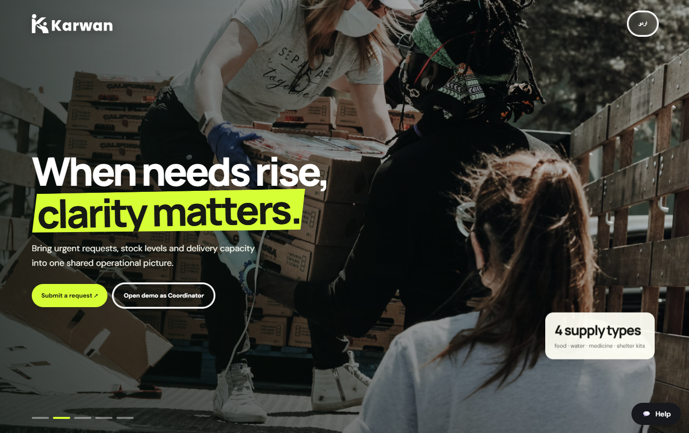<br><sub><b>Home</b>: bilingual landing page, Open demo button, help bot at the bottom right</sub></td>
<td width="50%">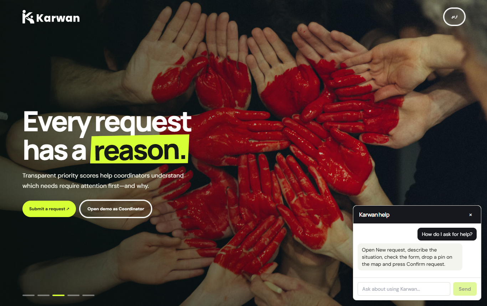<br><sub><b>Help bot</b>: answers only how to use the website</sub></td>
</tr>
<tr>
<td>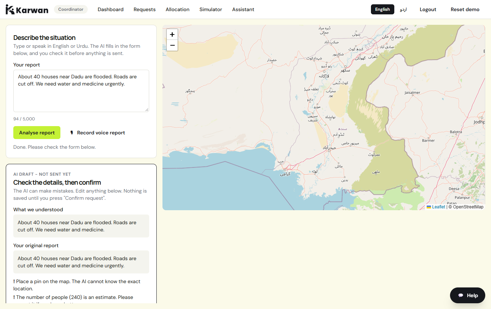<br><sub><b>Report by text or voice</b>: AI fills the form, you check and confirm</sub></td>
<td>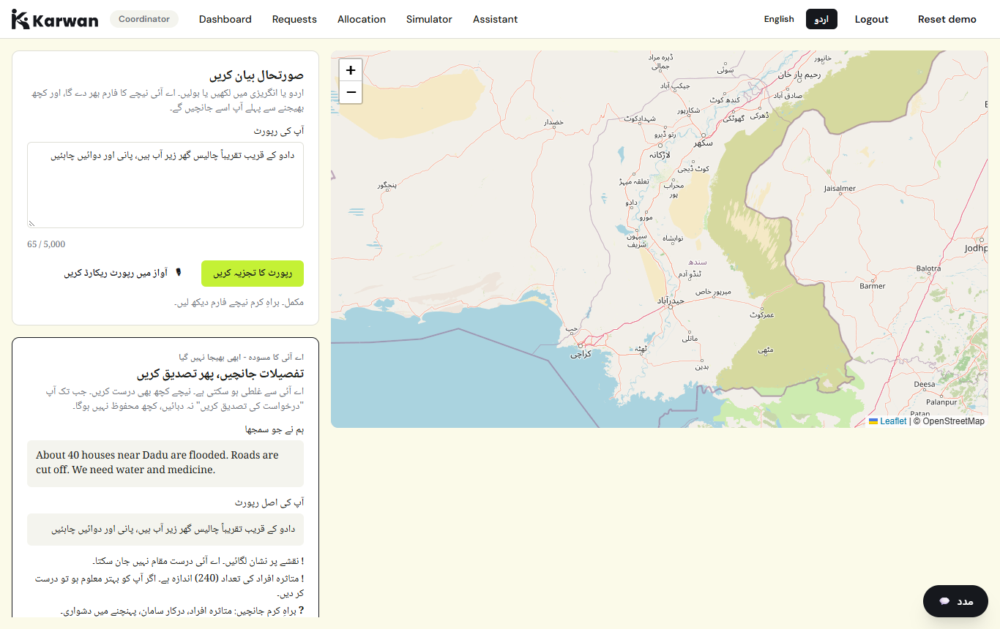<br><sub><b>Urdu, right to left</b>: a report in Urdu is understood and translated</sub></td>
</tr>
<tr>
<td>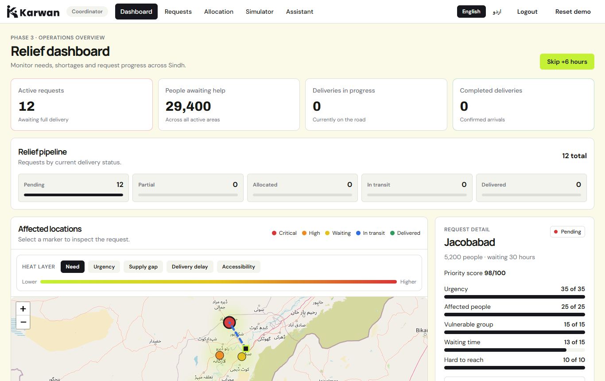<br><sub><b>Dashboard</b>: KPIs, relief pipeline, heat layers, request detail</sub></td>
<td>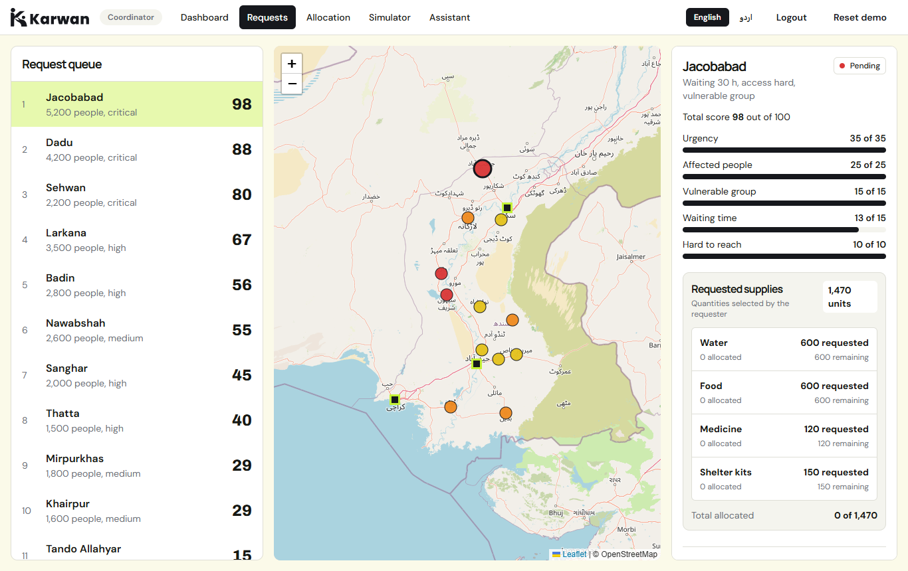<br><sub><b>Priority ranking</b>: every point of the score is visible, weights are adjustable</sub></td>
</tr>
<tr>
<td>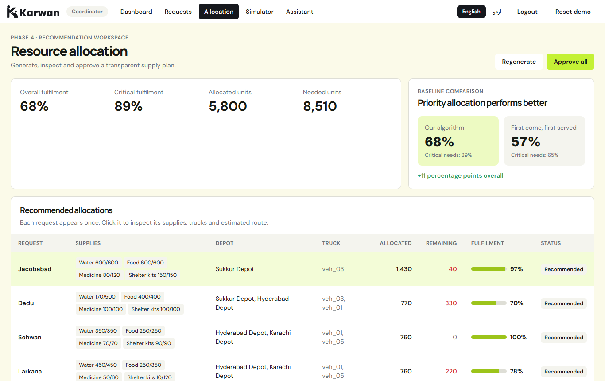<br><sub><b>Allocation</b>: recommended plan, reasons, baseline comparison</sub></td>
<td>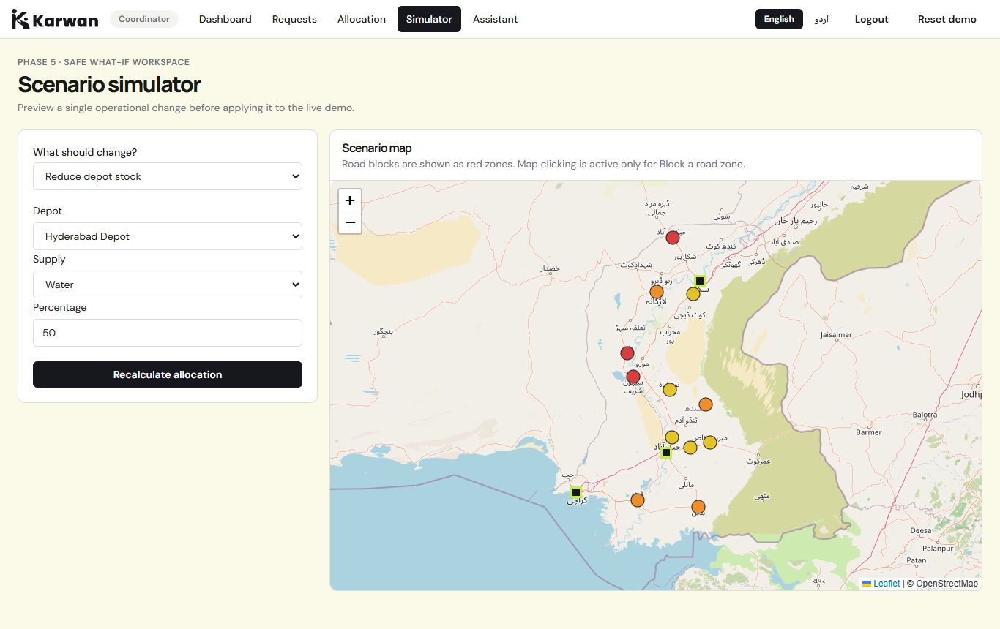<br><sub><b>What-if simulator</b>: change stock, needs or roads and see who gains or loses</sub></td>
</tr>
<tr>
<td>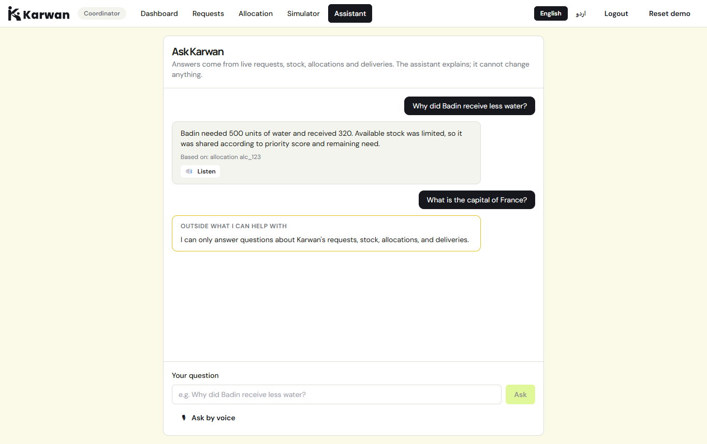<br><sub><b>Coordinator assistant</b>: exact numbers from live data, refuses off-topic questions</sub></td>
<td>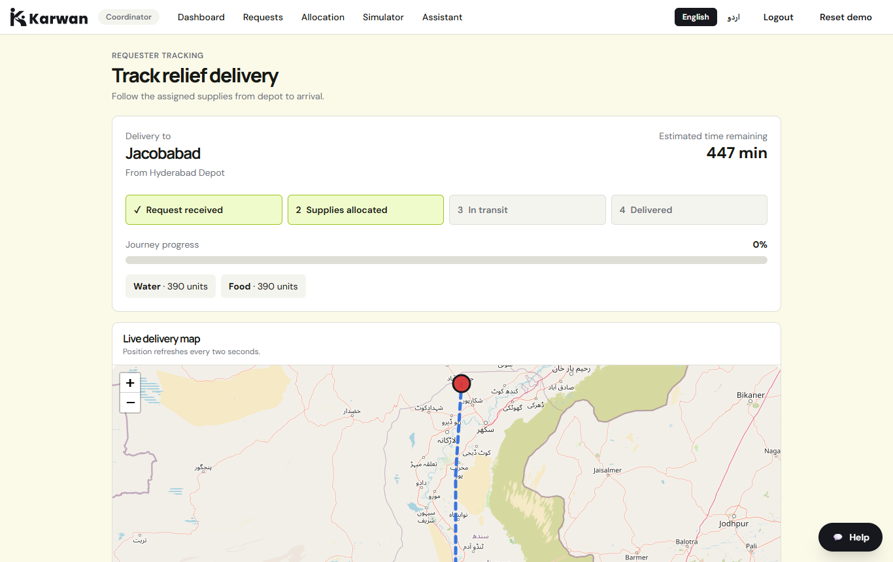<br><sub><b>Delivery tracker</b>: the community sees the truck and ETA</sub></td>
</tr>
</table>

## Features

### Core (the MVP from the brief)

| Expected MVP | Status | Where |
|---|:--:|---|
| Register requests with location, urgency and required supplies | ✅ | `/requester`: map pin, urgency, people affected, 4 supply types |
| Record available inventory and delivery capacity | ✅ | `/inventory`: stock, low-stock thresholds, daily capacity, trucks |
| Prioritise with transparent criteria | ✅ | `/requests`: score breakdown, live re-ranking when weights change |
| Recommend allocations from stock, demand and distance | ✅ | `/allocation`: generate, read the reason for each row, approve |
| Show allocation status and delivery progress | ✅ | `/dashboard`, `/tracker`: KPIs, pipeline, markers, routes, moving trucks |
| Show how allocations change when supplies or needs change | ✅ | `/simulator`: six what-if actions with before/after |

### Karwan 2.0: the AI layer

- **Report by text or voice, in Urdu or English** → editable form with per-field confidence and an "Estimate" label for derived people counts → a person confirms → the existing API saves and scores it. **Nothing is saved before Confirm.**
- **Coordinator assistant** (`/assistant`): ask about requests, scores, stock, allocations and deliveries. Exact stored numbers, source IDs, read-aloud, voice questions, and a fixed refusal for anything else.
- **Website help bot** on the home, requester, tracker and login pages. It knows only how to use Karwan and has no access to live data.
- **English / اردو** across the new screens, right-to-left where it matters.
- **Open demo as Coordinator** for judges, with no login.
- **Resilient by design**: manual form always works, friendly errors with retry, two-key quota fail-over, request tracing with `X-Request-Id`.

### Beyond the MVP

- **What-if simulator** with six actions: reduce or add stock, raise a population, add a request, change depot capacity, block a road zone. Apply or undo.
- **Five map heat layers**: Need, Urgency, Supply gap, Delivery delay, Accessibility.
- **Driver app**: assigned load, route, *Start trip*, *Mark delivered*.
- **Requester tracker** with progress, ETA and live truck position.
- **Live updates** over Supabase Realtime with automatic polling fallback.
- **Skip +6 hours** to show how waiting time moves requests up the ranking.
- **One-click demo reset**, role-based screens, and a bilingual landing page.

### Who uses what

| Role | Screens | Job |
|---|---|---|
| Community member | `/requester`, `/tracker` | Ask for help, see when it arrives. No login. |
| Coordinator | `/dashboard`, `/requests`, `/allocation`, `/simulator`, `/assistant` | Rank needs, approve plans, test scenarios, ask questions |
| Depot manager | `/inventory` | Keep stock, capacity and trucks accurate |
| Driver | `/driver` | Start the trip, confirm the delivery |

### From request to doorstep


## How it decides

### Priority score

Each request gets a score out of 100 made of five parts that always add up to the total shown, so nobody has to trust a black box.


**Urgency** (low to critical) · **Affected people** (scaled against the largest request) · **Vulnerable group** (children, elderly, patients) · **Waiting time** (grows over 48 h, then caps) · **Hard to reach** (easy, medium, hard). Move a slider and the ranking re-sorts.

### Allocation

1. **Share the stock** across requests in proportion to *priority score × amount needed*, never more than asked, redistributing leftovers.
2. **Pick the depot**: nearest with stock, daily capacity and a free truck. A blocked zone adds a 1.5× distance penalty.
3. **Explain it**: every row says which depot, how far, and why a request got less than it asked for.
4. **Compare** with a first-come-first-served baseline.
5. **Approve**: deducts stock, assigns trucks, writes dispatch logs and updates request status.

ETA comes from road distance, an average speed and loading time. Routes come from OSRM and are cached. If OSRM is down, Karwan draws a dashed straight-line estimate so nobody mistakes it for a real route.


## Product requirements (PRD)

Full documents: [Karwan PRD](docs/PRD.md) · [Karwan 2.0 PRD](ai-service/reference-docs/PRD.md)

<details open>
<summary><b>Summary</b></summary>

- **Problem:** relief requests, depot stock and truck capacity are scattered, so the worst-hit and hardest-to-reach areas are served last.
- **Goal:** one place to register needs, record stock and capacity, rank with transparent criteria, recommend allocations and track delivery. Karwan 2.0 adds report understanding in Urdu and English without replacing the rule-based engine.
- **Users:** community reporter, coordinator, depot manager, driver, community requester.
- **Karwan 2.0 principle:** *the existing backend calculates and decides; AI understands and explains.*
- **Karwan 2.0 goals:** text and voice reports in Urdu and English · human review before saving · scoped assistant that never invents numbers · manual form always available · judge-friendly open demo · Gemini keys only on the AI service.
- **Non-goals:** AI replacing scoring or allocation, rewriting Express in Python, AI approving allocations or changing stock, automatic rejection from credibility, real authentication, WhatsApp/SMS, Sindhi, multi-stop routing.
- **Success criteria:** an Urdu or English voice report becomes an editable request · nothing is saved before confirmation · the confirmed request enters the existing flow · the assistant quotes exact stored figures and refuses off-topic questions · AI failure never blocks the manual form · no Gemini key in the frontend.
- **Delivery phases:** Phase 1 AI sidecar (done) · Phase 2 optional credibility metadata (not built) · Phase 3 polish.
</details>

## Technical requirements (TRD)

Full documents: [Karwan TRD](docs/TRD.md) · [Karwan 2.0 TRD](ai-service/reference-docs/TRD.md) · [AI integration contract](backend/AI_INTEGRATION_CONTRACT.md) · [Hand-off and deploy guide](docs/KARWAN_2_HANDOFF.md)

### Architecture

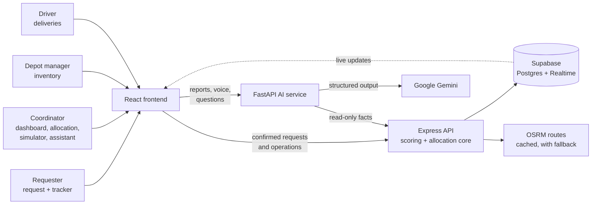

**Governing rules:** Express stays authoritative · scoring and allocation are not ported to Python · Gemini never calculates a score or allocation · Gemini keys live only in the AI service · AI intake does not persist a request · only the existing `POST /api/requests` saves a confirmed request · AI failure never interrupts the manual workflow.

### Report to score (sequence)

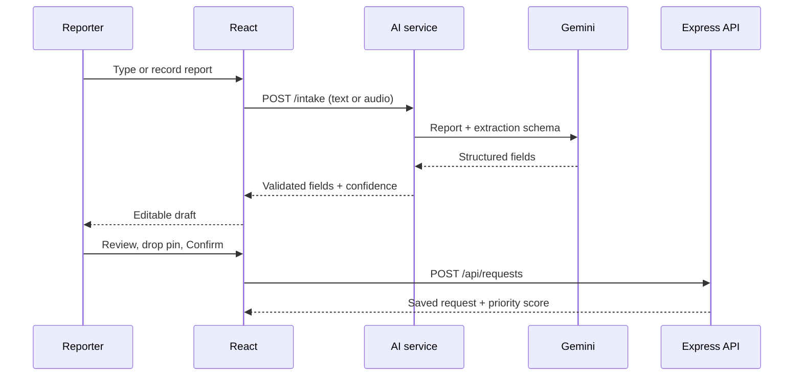

### API at a glance

| Service | Endpoint | Purpose |
|---|---|---|
| Express | `GET/POST /api/requests`, `GET/PATCH /api/requests/:id` | Requests and scores |
| Express | `GET/PUT /api/settings/weights` | Score weights |
| Express | `GET /api/depots`, `PATCH /api/depots/:id/inventory`, `POST /api/depots/:id/vehicles` | Stock and trucks |
| Express | `POST /api/allocation/generate`, `POST /api/allocation/approve`, `GET /api/allocation` | Plans |
| Express | `POST /api/simulate/*`, `GET /api/dashboard`, `GET /api/routes`, `GET/POST /api/deliveries*` | Simulator, dashboard, routing, delivery |
| AI | `GET /health` | Wake-up and health, never calls Gemini |
| AI | `POST /intake`, `POST /transcribe` | Report understanding and transcription |
| AI | `POST /chat`, `POST /site-chat` | Coordinator assistant and website help bot |

Interactive docs with examples: `http://localhost:8000/docs` · exported spec: [`ai-service/docs/openapi.json`](ai-service/docs/openapi.json). Error format everywhere: `{ "error": { "code", "message", "retryable", "details" }, "requestId" }`.

### Repository layout

```
frontend/      React 18 · Vite · Tailwind · Leaflet · i18n (en/ur) · AI client and mocks
backend/       Express 5: core/ (score, allocation, truck progress: pure logic) · services/ · repositories/ · validators/ · tests/ · sql/
ai-service/    FastAPI: routes/ · services/ · prompts/ · tests/ · scripts/ · docs/ (OpenAPI, samples)
docs/          PRD · TRD · user flow · design · Karwan 2.0 hand-off guide
assets/        Banner, animated visuals, screenshots, brand files
```

Scoring and allocation are kept free of database code so they can be tested on their own.

## User flows

Full document: [User flow](docs/USER_FLOW.md) · [Karwan 2.0 user flow](ai-service/reference-docs/USER_FLOW.md)

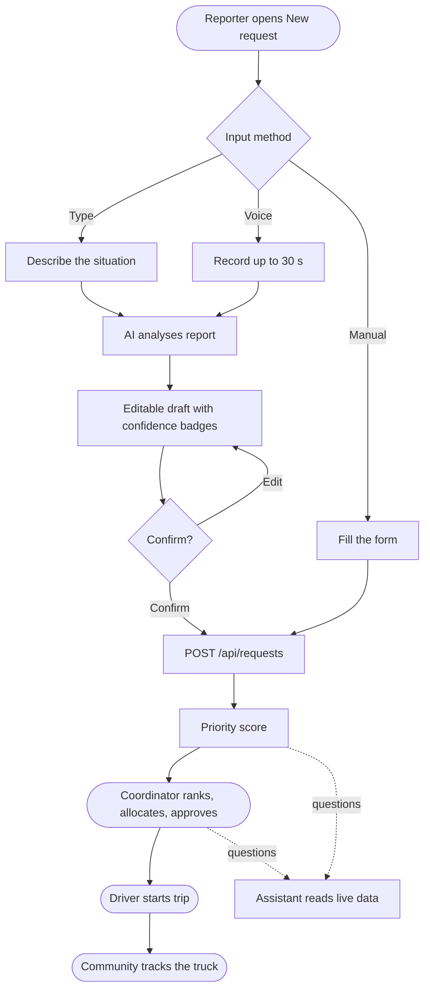

### Watch it work (4 minutes)

1. **Home** → **Open demo as Coordinator** → dashboard KPIs, markers, heat layers.
2. **New request** → switch to **اردو** → type or record a report → **Analyse** → badges and translation → edit one field → drop a pin → **Confirm** → priority score.
3. **Allocation** → Generate → read one reason → Approve.
4. **Assistant** → "Why did Badin receive less water?" → press **Listen**. Then ask an off-topic question and see the refusal.
5. **Driver** → start the trip, the truck moves → **Tracker** shows it from the community side.
6. **Simulator** → cut water stock → see who gains or loses.
7. **Manual fallback** → stop the AI service and send a request by hand.

## Testing

| Suite | Command | Result |
|---|---|---|
| Express backend (34 files) | `cd backend && npm test` | 111 tests pass |
| AI service | `cd ai-service && .venv/Scripts/python -m pytest -q` | 66 tests pass |
| Frontend build | `cd frontend && npm run build` | builds clean |
| Secret scan | `python ai-service/scripts/check_secrets.py` | no keys in files or bundle |
| Contract check (deployed API) | `cd backend && API_URL=<url> npm run check:ai-contract` | verifies the five read endpoints |
| Real Gemini checks | `ai-service/scripts/try_intake.py`, `try_voice.py`, `try_chat.py` | run with your key |

AI tests use a fake Gemini, so they need no key. They cover quota fail-over, timeouts, malformed output, CORS, size limits, read-only access and the fixed refusals.

## Honest limits

- **Not an exact optimiser.** Allocation is a transparent heuristic (priority-weighted sharing, then nearest depot), not a linear-programming solver. We chose explainable over provably optimal, because a coordinator has to defend the plan.
- **Simulated data only.** No real requests, stock or road conditions.
- **AI quality depends on the model.** Extraction is checked by a human before saving; the Urdu interface text should be reviewed by a native speaker.
- **Voice** depends on browser recording and Gemini accepting the browser's audio format. Typing and the manual form always work.
- **Assistant** sees approved allocations (what `GET /api/allocation` returns), not an unapproved plan.
- **Demo-grade login.** Staff roles use client-side demo credentials. Real use needs proper authentication.
- **Optional credibility scoring** (PRD phase 2) is not built.
- **Straight-line fallback.** When road routing is unavailable, ETAs are estimates.

## What's next

- Multi-stop truck routes · real authentication and an audit trail · SMS or WhatsApp intake · offline-first driver screen · optional credibility scoring with verify/reject by a coordinator.

## Docs

| Doc | What it covers |
|---|---|
| [PRD](docs/PRD.md) · [Karwan 2.0 PRD](ai-service/reference-docs/PRD.md) | Problem, users, MVP, AI scope |
| [TRD](docs/TRD.md) · [Karwan 2.0 TRD](ai-service/reference-docs/TRD.md) | Stack, score formula, allocation, APIs, AI service |
| [User flow](docs/USER_FLOW.md) · [Karwan 2.0 flow](ai-service/reference-docs/USER_FLOW.md) | Step-by-step flows for every role |
| [Design](docs/DESIGN.md) | Colours, type, components, screens |
| [Hand-off guide](docs/KARWAN_2_HANDOFF.md) | Env vars, deploy, test checklist, demo script |
| [AI integration contract](backend/AI_INTEGRATION_CONTRACT.md) | Express ↔ AI service contract |
| [AI service README](ai-service/README.md) | Running, testing and deploying the AI service |

## Brand

<div align="center">

</div>

<br>

<div align="center">
<sub>Karwan · Team Triple Bytes · DITE Hackathon 2026-27 · Right help. Right place. Right now.</sub>
</div>
