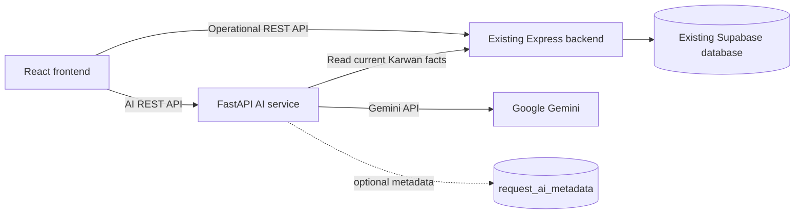

# Karwan 2.0 — Technical Requirements Document

**Architecture decision:** Preserve the existing React, Express, and Supabase application. Add AI capabilities through a separate FastAPI microservice.

## 1. System boundaries

Karwan 2.0 consists of three runtime parts:

1. **React frontend** — presents existing screens plus AI intake, confirmation, assistant, language, and open-demo controls.
2. **Existing Express backend** — remains the operational source of truth for requests, scoring, allocation, inventory, dashboard, routing, simulation, and delivery.
3. **AI FastAPI service** — handles Gemini-backed report understanding, transcription, scoped explanations, and optional credibility assessment.

Supabase remains the operational database.



## 2. Governing technical rules

1. The existing Express backend remains authoritative.
2. Existing score and allocation modules are not ported to Python.
3. Gemini never calculates an authoritative score or allocation.
4. Gemini keys exist only in the AI service.
5. The frontend may call both services, but it never calls Gemini directly.
6. AI intake does not persist a request.
7. Only the existing `POST /api/requests` endpoint saves confirmed operational requests.
8. The assistant reads current facts from the existing API for every question or from a short-lived server-side cache.
9. AI failure must not interrupt the manual request workflow.
10. Optional credibility data must be separated from core operational data unless a later migration is approved.

## 3. Existing system retained

The following current modules remain unchanged in responsibility:

| Area | Existing implementation |
|---|---|
| Frontend | React 18, Vite, Tailwind, React Router |
| Operational backend | Node.js 22, Express 5 |
| Database | Supabase Postgres |
| Priority score | `backend/src/core/score.js` |
| Allocation | `backend/src/core/allocation.js` |
| Delivery movement | `backend/src/core/truckProgress.js` and delivery services |
| Database access | Existing repository layer |
| Maps | Leaflet and React Leaflet |
| Routes | OSRM with cached estimated fallback |
| Realtime | Supabase Realtime plus polling fallback |

## 4. AI service stack

| Concern | Choice |
|---|---|
| Framework | FastAPI on Python 3.11+ |
| Validation | Pydantic |
| Gemini SDK | `google-genai` |
| HTTP client | `httpx` |
| Audio input | Multipart `audio/webm` or the actual browser-supported MIME type |
| Hosting | Railway preferred; Hugging Face Spaces is the fallback |
| Secrets | Platform environment variables |
| Text-to-speech | Browser `speechSynthesis` first |

Suggested independent folder:

```text
ai-service/
├─ app/
│  ├─ main.py
│  ├─ config.py
│  ├─ models.py
│  ├─ routes/
│  │  ├─ health.py
│  │  ├─ intake.py
│  │  ├─ transcribe.py
│  │  ├─ chat.py
│  │  └─ credibility.py
│  ├─ services/
│  │  ├─ gemini_client.py
│  │  ├─ intake_service.py
│  │  ├─ chat_service.py
│  │  ├─ credibility_service.py
│  │  └─ karwan_api_client.py
│  └─ prompts/
│     ├─ intake.py
│     ├─ chat.py
│     └─ credibility.py
├─ tests/
├─ requirements.txt
├─ Dockerfile
└─ .env.example
```

The AI service may live in the same repository as a separate deployable folder or in a separate repository. It must not be mixed into the existing Express runtime.

## 5. AI service API

### 5.1 `GET /health`

Purpose: platform health check and free-host wake-up.

Response:

```json
{
  "status": "ok",
  "service": "karwan-ai"
}
```

The health endpoint should not call Gemini.

### 5.2 `POST /intake`

Purpose: convert natural-language text or one voice recording into structured request fields. It does not save data.

Content type: `multipart/form-data`

Fields:

- `text`: optional string
- `audio`: optional file
- `ui_language`: `en` or `ur`

Exactly one of `text` or `audio` is required.

Response:

```json
{
  "area": "Dadu",
  "people": 240,
  "peopleIsEstimate": true,
  "urgency": "high",
  "vulnerable": ["children", "medical"],
  "supplies": [
    { "item": "water", "qty": 500 }
  ],
  "access": "hard",
  "detectedLanguage": "ur",
  "englishText": "Forty houses near Dadu are flooded.",
  "confidence": {
    "area": 0.95,
    "people": 0.65,
    "urgency": 0.8,
    "vulnerable": 0.9,
    "supplies": 0.4,
    "access": 0.3
  }
}
```

Unknown values should be returned as `null`, an empty list, or confidence `0`; the model must not invent a location or supply quantity.

Pydantic validates the model output. One repair or retry is permitted for invalid structured output. After that, return a friendly error.

### 5.3 `POST /transcribe`

Purpose: convert short audio into text for microphone-enabled fields or assistant questions.

Input: multipart audio plus optional target language.

Response:

```json
{
  "text": "Dadu needs water and medicine.",
  "detectedLanguage": "ur"
}
```

### 5.4 `POST /chat`

Purpose: answer questions about live Karwan data.

Request:

```json
{
  "question": "Why did Badin receive less water?",
  "uiLanguage": "en"
}
```

Server process:

1. Validate the question.
2. Fetch current data from the configured existing Express API.
3. Build a compact, labelled context.
4. Send the question and context to Gemini.
5. Validate structured output.
6. Return the answer or a fixed refusal.

Response:

```json
{
  "inScope": true,
  "answer": "Badin needed 500 units of water and received 320. Available stock was limited, so it was shared according to priority score and remaining need.",
  "sources": [
    { "type": "allocation", "id": "alc_example" }
  ]
}
```

Out-of-scope response:

```json
{
  "inScope": false,
  "answer": "I can only answer questions about Karwan's requests, stock, allocations, and deliveries.",
  "sources": []
}
```

### 5.5 `POST /credibility` — optional

Purpose: return non-authoritative credibility metadata for a confirmed report.

Response:

```json
{
  "score": 64,
  "band": "amber",
  "flags": ["Possible duplicate report"],
  "reasons": ["A similar report was submitted for Dadu recently"]
}
```

This endpoint cannot reject, delete, or alter an operational request.

## 6. Frontend integration

### 6.1 API clients

Keep the existing operational client and add an AI client:

```text
frontend/src/lib/api.js       existing Express API
frontend/src/lib/aiApi.js     new AI service API
```

Environment variables:

```env
VITE_API_URL=https://existing-karwan-backend.example.com
VITE_AI_API_URL=https://karwan-ai.example.com
```

Only service URLs may use `VITE_*`. Gemini keys must not be included.

### 6.2 Request mapping

The confirmation screen maps AI output to the current request contract:

```js
{
  area: result.area,
  lat: selectedPin.lat,
  lng: selectedPin.lng,
  population: result.people,
  urgency: result.urgency,
  vulnerable: result.vulnerable.length > 0,
  accessibility: result.access,
  items: result.supplies.map((supply) => ({
    item: supply.item,
    qtyNeeded: supply.qty,
  })),
}
```

The mapped request is submitted through the existing `createRequest` frontend function and existing Express endpoint.

### 6.3 Suggested components

```text
AiReportInput.jsx
MicButton.jsx
ConfirmRequestCard.jsx
ConfidenceBadge.jsx
AssistantPanel.jsx
SpeakerButton.jsx
LanguageToggle.jsx
OpenDemoButton.jsx
```

### 6.4 State model for intake

```text
idle
  → recording
  → analysing
  → reviewing
  → saving
  → saved
```

Failures return to `idle` or `reviewing` without clearing reporter input.

## 7. Chat data integration

The AI service reads, at minimum:

```text
GET {KARWAN_API_URL}/api/requests
GET {KARWAN_API_URL}/api/allocation
GET {KARWAN_API_URL}/api/depots
GET {KARWAN_API_URL}/api/dashboard
GET {KARWAN_API_URL}/api/deliveries
```

Context should contain only the fields needed to answer operational questions. Large payloads should be reduced by:

- Matching named areas in the question.
- Including top-ranked or active requests only when the question is general.
- Including allocation reason strings and authoritative quantities.
- Excluding internal secrets and irrelevant metadata.
- Enforcing a maximum context size.

The prompt must state that DATA is authoritative and missing facts must be acknowledged rather than invented.

## 8. Optional AI metadata storage

To preserve the existing backend, optional credibility and extraction metadata can use a separate table:

```sql
create table request_ai_metadata (
  request_id text primary key,
  raw_text text,
  english_text text,
  detected_language text,
  people_is_estimate boolean default false,
  field_confidence jsonb default '{}'::jsonb,
  credibility_score int,
  credibility_band text,
  credibility_flags jsonb default '[]'::jsonb,
  credibility_reasons jsonb default '[]'::jsonb,
  verification_status text default 'ok',
  created_at timestamptz default now(),
  updated_at timestamptz default now()
);
```

Recommended verification values:

```text
ok | needs_review | verified | rejected
```

The AI service may own this table. Operational requests remain in the existing tables. Any later decision to exclude rejected requests from allocation requires an explicit integration change and is outside the unchanged-backend guarantee.

## 9. Security and privacy

- Gemini keys are stored only in AI-service environment variables.
- The AI service allows CORS only from the deployed frontend origin.
- Audio size and duration are limited.
- Supported MIME types are allow-listed.
- Request bodies have size limits.
- AI routes use timeouts and controlled retries.
- Only simulated demo data is sent to Gemini.
- Logs must not print keys or complete audio contents.
- The AI service must not receive the Supabase service key unless optional metadata storage requires it.
- If metadata storage is enabled, use a dedicated server-side key and least-privilege database policy where possible.

## 10. Environment variables

AI service:

```env
GEMINI_KEY_A=
GEMINI_KEY_B=
GEMINI_MODEL=
KARWAN_API_URL=
FRONTEND_ORIGIN=
AI_REQUEST_TIMEOUT_SECONDS=20

# Optional metadata only
SUPABASE_URL=
SUPABASE_SERVICE_KEY=
```

Frontend:

```env
VITE_API_URL=
VITE_AI_API_URL=
```

Existing Express backend variables remain unchanged.

## 11. Deployment

### AI service on Railway

- Deploy the `ai-service` directory or repository.
- Start with `uvicorn app.main:app --host 0.0.0.0 --port $PORT`.
- Configure environment variables in Railway.
- Confirm `/health` works without calling Gemini.
- Restrict CORS to the frontend origin.
- Add the deployed URL to `VITE_AI_API_URL`.

Hugging Face Spaces may be used as a fallback if Railway is unavailable.

### Existing deployments

- Existing frontend and Express deployments remain in place.
- Existing `VITE_API_URL` continues pointing to the Express backend.
- No existing backend endpoint is redirected to the AI service.

## 12. Error contract

The AI service returns:

```json
{
  "error": {
    "code": "AI_UNAVAILABLE",
    "message": "The AI assistant is busy. You can continue with the manual form."
  }
}
```

Recommended codes:

```text
VALIDATION_ERROR
UNSUPPORTED_AUDIO
AUDIO_TOO_LARGE
AI_TIMEOUT
AI_QUOTA_EXCEEDED
AI_INVALID_OUTPUT
AI_UNAVAILABLE
KARWAN_API_UNAVAILABLE
```

Frontend messages should be actionable and must preserve user-entered data.

## 13. Verification requirements

The implementation should verify:

- English text extraction.
- Urdu text extraction.
- Voice upload and extraction.
- Unknown fields remain empty instead of being invented.
- Manual fallback works when the AI service is offline.
- Confirmed output matches the existing request API schema.
- Existing score and allocation outputs remain authoritative.
- Chat answers use current allocation values.
- Chat refuses unrelated questions.
- Gemini keys are absent from the frontend bundle.
- Open demo reaches the coordinator dashboard without credentials.

These checks are additive; the existing backend test suite remains unchanged.

