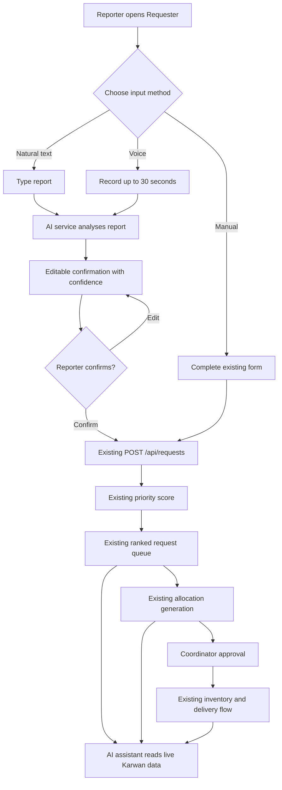
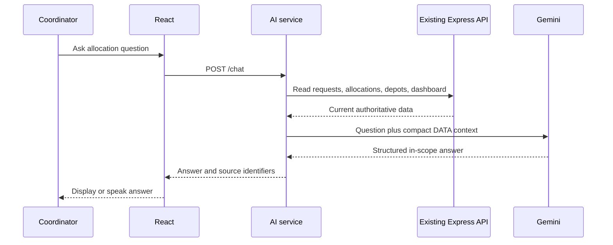
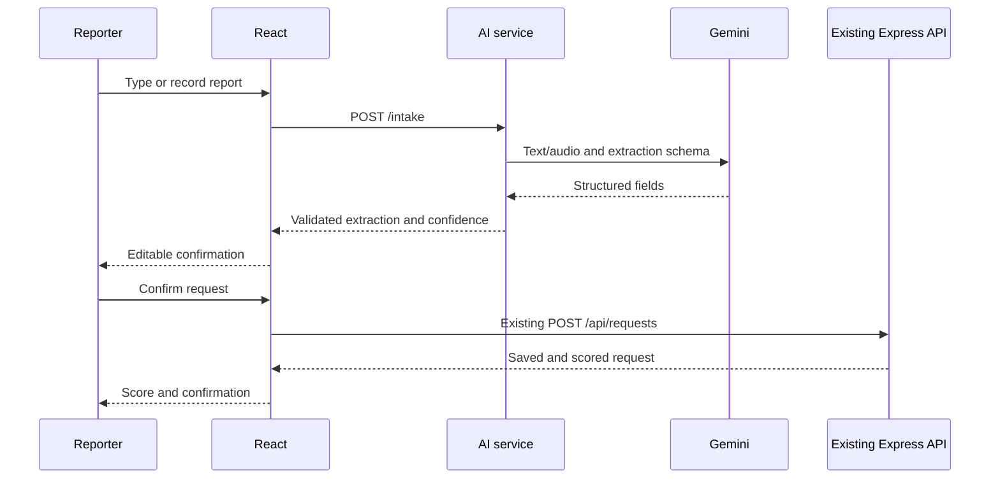

# Karwan 2.0 — User Flow

**Flow decision:** AI is an optional assistance layer before request creation and during explanation. All confirmed requests continue through the existing Karwan operational flow.

## 1. Roles and entry points

| Role | Entry | Main goal |
|---|---|---|
| Reporter | Requester screen | Describe needs and confirm an accurate request |
| Coordinator | Open demo or existing login | Review priorities, approve allocations, and ask for explanations |
| Depot manager | Existing login | Maintain stock, capacity, and vehicles |
| Driver | Existing login | Start and complete assigned deliveries |
| Community requester | Public tracker | Track delivery progress |

## 2. Complete system flow



## 3. Flow A — Submit a report using natural text

1. The reporter opens **New request**.
2. The reporter selects English or Urdu.
3. The reporter enters a report in the AI report box.
4. The reporter presses **Analyse report**.
5. The frontend sends the text and selected language to the AI service.
6. A loading message appears without removing the entered report.
7. The AI service returns structured fields and confidence values.
8. The frontend opens the confirmation view.
9. The reporter reviews and edits every relevant field.
10. The reporter places a map pin if coordinates are missing.
11. The reporter presses **Confirm request**.
12. The frontend transforms the confirmed fields into the existing request API format.
13. The existing Express backend saves and scores the request.
14. The reporter sees the saved request, priority score, and score breakdown.

```text
Text report → Analyse → Review → Edit → Confirm → Existing request API → Score
```

## 4. Flow B — Submit a report using voice

1. The reporter opens **New request**.
2. The reporter presses the microphone button.
3. The browser requests microphone permission.
4. Recording begins and shows elapsed time.
5. The reporter stops recording, or recording stops at approximately 30 seconds.
6. The frontend uploads the audio to the AI service.
7. The AI service transcribes and extracts the report.
8. The original or translated text is displayed with the structured fields.
9. The reporter reviews, edits, and confirms the fields.
10. The existing request API saves and scores the confirmed request.

### Voice error branches

| Situation | Result |
|---|---|
| Permission denied | Show “Microphone is blocked. Type your report instead.” |
| Unsupported browser | Hide or disable recording and keep text/manual entry available |
| Empty or unclear audio | Ask the reporter to retry or type the report |
| AI timeout or quota | Preserve the report and open the manual form |
| Missing location | Highlight location and require a map pin |

## 5. Flow C — Use the manual fallback

1. The reporter chooses **Enter manually**, or an AI operation fails.
2. The existing fields remain available:
   - Area
   - Map pin
   - People affected
   - Urgency
   - Accessibility
   - Vulnerable group indicator
   - Supply quantities
3. The reporter completes the form.
4. Existing validation runs.
5. The request is submitted directly to the existing Express backend.

The AI service is not required for this flow.

## 6. Flow D — Review AI extraction

The confirmation screen displays:

- Original report
- Detected language
- English translation when applicable
- Extracted request fields
- Confidence badge beside each AI-generated field
- Estimated label for derived people counts
- Inline validation errors

Suggested confidence presentation:

| Confidence | Display |
|---:|---|
| 0.80–1.00 | High confidence |
| 0.50–0.79 | Check this field |
| Below 0.50 | Needs confirmation |

Confidence never prevents editing or confirmation. Required fields must still pass the existing form validation.

## 7. Flow E — Continue through existing Karwan operations

After the request is saved, no AI is required for the operational workflow.

```text
Saved request
  → Existing transparent priority score
  → Coordinator reviews ranked requests
  → Existing allocation engine generates plan
  → Coordinator reads reasons and baseline
  → Coordinator approves
  → Existing stock deduction and logs
  → Existing driver starts trip
  → Existing requester tracker follows delivery
  → Driver marks delivery complete
```

The simulator, heat layers, routes, and tracking continue to work as they currently do.

## 8. Flow F — Enter the open coordinator demo

1. A judge opens the landing page or login page.
2. The judge presses **Open demo as Coordinator**.
3. The frontend creates the current demo coordinator session.
4. The judge is sent to `/dashboard`.
5. Coordinator navigation is immediately available.

```text
Live link → Open demo as Coordinator → Dashboard
```

The existing role login can remain available for depot-manager and driver demonstrations.

## 9. Flow G — Ask the coordinator assistant

1. The coordinator opens the Assistant page or drawer.
2. The coordinator types a question or records it with the microphone.
3. The frontend sends the question and interface language to the AI service.
4. The AI service requests current data from the existing Karwan API.
5. The AI service builds a limited context containing authoritative numbers and stored reasons.
6. Gemini decides whether the question is in scope.
7. For an in-scope question, Gemini explains the supplied facts.
8. The answer appears in the selected language.
9. The coordinator may press the speaker button to hear the answer.

Example:

```text
Coordinator: Why did Badin receive less water?

Assistant: Badin needed 500 units and received 320. Available water stock
was limited, so it was shared according to priority score and remaining
need. The allocation came from the nearest usable depot.
```

## 10. Flow H — Refuse an off-topic question

1. The coordinator asks a question unrelated to Karwan.
2. The AI service returns `inScope: false`.
3. The frontend shows the fixed response:

> I can only answer questions about Karwan's requests, stock, allocations, and deliveries.

The assistant does not attempt a general answer.

## 11. Flow I — Switch language

1. The user selects English or Urdu.
2. New AI-facing labels change language.
3. Urdu content uses right-to-left layout.
4. The selected language is sent with intake and chat requests.
5. The assistant answers in the selected language.
6. Existing screens may adopt complete translation incrementally.

## 12. Flow J — Optional credibility assessment

If the optional credibility phase is enabled:

1. A confirmed request is saved through the existing Express backend.
2. The frontend or AI service sends the saved request to `/credibility`.
3. The AI service returns score, band, flags, and reasons.
4. The result is stored in `request_ai_metadata` using the request ID.
5. The dashboard combines the operational request with its AI metadata.
6. Red reports appear as **Needs review**.
7. A coordinator may mark the metadata as verified or rejected.
8. No report is automatically rejected.

This optional flow does not change the existing request unless a separate integration is explicitly implemented.

## 13. Assistant data flow



## 14. Intake data flow



## 15. Demo flow

1. Open the live application in an incognito window.
2. Press **Open demo as Coordinator** to demonstrate unrestricted access.
3. Show the existing dashboard and operational data.
4. Open the requester screen.
5. Record or type an Urdu report.
6. Analyse it and show confidence indicators.
7. Correct one field to demonstrate human control.
8. Confirm the request and show the existing priority score.
9. Generate and approve the allocation using the existing engine.
10. Ask the assistant why one area received a partial quantity.
11. Play the answer using the speaker button.
12. Ask one off-topic question and show the refusal.
13. Briefly demonstrate that simulator, driver, and tracker flows remain available.

## 16. Empty and failure states

| Situation | User-facing behaviour |
|---|---|
| AI service is waking | “Starting the AI assistant. This may take up to a minute.” |
| AI analysis fails | Preserve input and offer Retry or Enter manually |
| Existing backend is unavailable | Explain that the request cannot be saved yet; preserve confirmed fields |
| No allocations exist | Assistant explains that an allocation must be generated first |
| Requested fact is absent | Assistant says the information is not available |
| Speech voice is unavailable | Hide or disable speaker playback while preserving text answers |
| No requests exist | Keep existing empty state and provide a route to submit or reset demo data |

